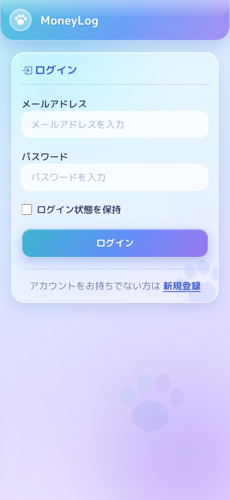
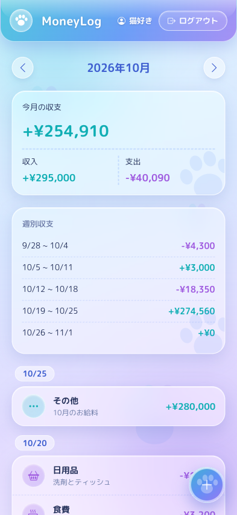

# MoneyLog

スマホで手軽に収入・支出を記録して、月ごと・週ごとの収支をすぐ確認できる家計簿アプリです。
アカウントを作ると、記録はユーザーごとに分けて保存されます。

- **公開URL**: https://catmoneylog-2438.com/

## 画面
スマホでの利用を想定しているアプリのため、スクリーンショットもスマホサイズ（393 × 852）で撮影しています。
ログイン後はどの画面でも、ヘッダーの「MoneyLog」をタップするとホーム画面に戻れます。

### ログイン画面


メールアドレスとパスワードでログインします。「ログイン状態を保持」にチェックを入れると、次回からログインを省略できます。アカウントがない場合は、下部のリンクからサインアップ画面へ移動できます。

### ホーム画面


その月の収支（今月の収支・収入・支出の合計）、週ごとの収支内訳、日別の収支一覧をまとめて確認できます。上部の矢印で前後の月へ移動でき、画面右下の「＋」ボタンから新規登録画面へ移動します。

### 新規登録画面


収入・支出の種別、金額、カテゴリ、日付、メモを入力して家計簿に記録できます。カテゴリはボタンをタップするだけで選択できます。

### 編集・削除画面


ホーム画面の日別リストから項目をタップすると開きます。入力内容を直して「編集する」で更新、「削除する」でその記録を消せます。

## 主な機能
- サインアップ・ログイン・ログアウト（ログイン状態の保持つき）
- 記録のユーザーごとの分離（他人の記録は閲覧も編集もできない）
- 収入・支出の登録・編集・削除
- 月別の収支（収入・支出・差引）の表示と、前後の月への移動
- 週ごとの収支内訳（月曜はじまり）と、今週の収支の表示
- 日別の収支一覧（カテゴリのアイコン・メモつき）
- カテゴリ（食費・日用品・交通費・趣味・光熱費・その他）の選択

## 技術スタック

| 分類 | 使用技術 |
|---|---|
| バックエンド | PHP 8.5 / Laravel 13 |
| フロントエンド | Blade / CSS（ビルドツールなし） |
| データベース | MySQL |
| 認証 | Laravel 標準のセッション認証（`auth`・`guest` ミドルウェア） |
| テスト | PHPUnit |
| CI | GitHub Actions（push・プルリクエストごとに自動テスト） |
| 本番環境 | ConoHa VPS（Ubuntu 24.04）/ Nginx / PHP-FPM / MySQL 8.0 / Let's Encrypt |

本番環境は、Heroku から VPS に移し、サーバーを自分で構築して公開しています。構成とデプロイの方法は [本番環境とデプロイ](docs/deployment.md) にまとめています。

## ローカルでの動かし方

### 必要なもの
- PHP 8.4 以上（開発では 8.5 を使用）と、拡張機能 `pdo_mysql`・`mbstring`・`xml`・`curl`・`zip`・`bcmath`・`intl`
- Composer
- MySQL

### 手順
1. リポジトリを取ってくる
   ```bash
   git clone https://github.com/kentaro-nakayama/MoneyLog.git
   cd MoneyLog
   ```
2. ライブラリを入れる
   ```bash
   composer install
   ```
3. 設定ファイルを作る
   ```bash
   cp .env.example .env
   php artisan key:generate
   ```
   `.env` の `DB_` で始まる行のコメント（`#`）を外し、自分の MySQL のデータベース名・ユーザー名・パスワードに書き換えます。
4. テーブルを作る
   ```bash
   php artisan migrate
   ```
5. 起動する
   ```bash
   php artisan serve
   ```
   ブラウザで http://localhost:8000 を開きます。ログインが必要なので、初回は `/signup` からアカウントを作ってください。

## テスト
```bash
php artisan test
```

主にフィーチャーテストで、画面とルーティングを通した実際の動きを確認しています。

| テストファイル | 確認していること |
|---|---|
| `tests/Feature/SignupTest.php` | サインアップの成功・入力チェック・パスワードのハッシュ化・連続試行の制限 |
| `tests/Feature/LoginTest.php` | ログイン・ログアウト・ログイン状態の保持・連続失敗時の制限 |
| `tests/Feature/GuestAccessTest.php` | 未ログインでのアクセスがログイン画面へ飛ばされること |
| `tests/Feature/TransactionOwnershipTest.php` | 他人の記録を閲覧・編集・削除できないこと |
| `tests/Feature/TransactionValidationTest.php` | 登録フォームの入力チェック |
| `tests/Feature/HomeTotalsTest.php` | 月別・週別・日別の集計と、年をまたぐ月移動 |
| `tests/Feature/TransactionCastsTest.php` | `date` が Carbon、`amount` が整数として扱えること |
| `tests/Feature/HeaderTest.php` | ヘッダーのユーザー名表示とエスケープ |
| `tests/Feature/AppTimezoneTest.php` | タイムゾーンが環境変数から決まること |
| `tests/Feature/CssCacheBustingTest.php` | CSSのURLに更新日時が付くこと |
| `tests/Feature/UrlSchemeTest.php` | プロキシ配下で `https` のURLが生成されること |

テストは MySQL に接続するため、MySQL が起動していて `.env` の DB 設定が正しい必要があります。テスト用のデータベース名は `phpunit.xml` の `DB_DATABASE`（`money_log_testing`）です。

GitHub Actions でも、`main` への push とプルリクエストのたびに本番と同じ MySQL 8.0 で同じテストを走らせています（[.github/workflows/tests.yml](.github/workflows/tests.yml)）。

## 資料
- [要件定義書](docs/requirements.md)：想定ユーザー、機能要件（MoSCoW）、画面構成、データ設計、技術選定の経緯
- [本番環境とデプロイ](docs/deployment.md)：サーバー構成、セキュリティ、デプロイ・バックアップ・運用の方法
